# 你好，我是 lnuxe

> 腾讯开源生态贡献者 · 全栈 & 跨端开发探索者

长期向腾讯开源生态提交代码修复：三套主流 UI 组件库（Vue / React / 移动端）、微前端与跨端框架、小程序基础库、Markdown 编辑器。

方向是全栈 + 跨端，横跨 Web、小程序、移动端、鸿蒙与 Kotlin Multiplatform；语言从 Dart / Kotlin / Python / TypeScript 到 Swift / PHP 都在用，跨端框架上投入时间最多的是 Kuikly 与 PixUI。

工作之外写了个极光主题的单文件贪吃蛇——玻璃拟态、程序化音效、零依赖，打开即玩：[在线试玩](https://lnuxe.github.io/aurora-snake/)。

## 技术栈

  <picture>
    <source media="(prefers-color-scheme: dark)" srcset="https://raw.githubusercontent.com/lnuxe/lnuxe/main/assets/stack-dark.svg" />
    
  </picture>

## 贡献蛇

  <picture>
    <source media="(prefers-color-scheme: dark)" srcset="https://raw.githubusercontent.com/lnuxe/lnuxe/main/assets/aurora-snake-dark.svg" />
    
  </picture>

## 联系我

- 邮箱：[2213685984@qq.com](mailto:2213685984@qq.com)

---

图标来自 <a href="https://simpleicons.org">simple-icons</a> 与 <a href="https://devicon.dev">devicon</a>（均开源）；技术栈卡片与贡献蛇均由脚本自绘，配色取自 <a href="https://github.com/lnuxe/aurora-snake">aurora-snake</a>，每日自动重建，亮/暗主题自动切换。
